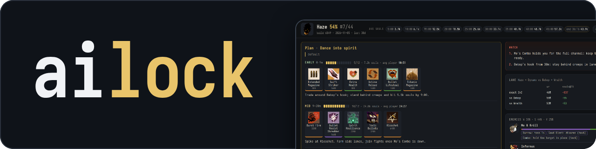
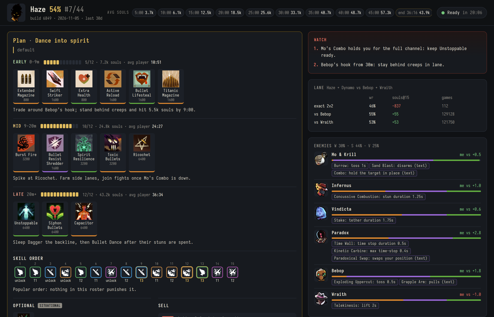

<p align="center">
  
</p>

<p align="center">
  A pre-game coach for Deadlock: give it your hero and both rosters while the match loads,
  and get a build, item corrections, a skill order and a game plan for that exact matchup.
</p>

---

Most build guides are written for a hero. ailock's live brief is written for the game you're about to
play. It pulls current win rates, matchups and popular builds, reads the abilities of all twelve
heroes from the live game files, and hands those facts to your coding agent, which makes the calls and
explains each one. The result opens in your browser, ready to read while the match loads.



## Quick start

You need [uv](https://docs.astral.sh/uv/) and a coding agent such as
[Claude Code](https://claude.com/claude-code), [Codex](https://developers.openai.com/codex) or
[OpenCode](https://opencode.ai). No Steam login or match history is required.

```sh
git clone https://github.com/eonflux7/ailock.git
cd ailock
uv sync
uv run ailock knowledge    # one-time game data download, under a minute; rerun after a patch
```

Start your agent in the `ailock` folder. Once you can see the rosters, send it:

```
/live haze; allies abrams seven ivy dynamo geist; enemies mo infernus vindicta paradox bebop wraith; lane dynamo vs bebop wraith
```

If your agent has no `/live` command, send the same message without the slash. Give as much of the
roster as you have. Hero names are fuzzy, so `mo`, `geist`, `talon` and `rat` all work.

## What's in the brief

- **Build:** the best fit from the 10 most played current builds, and why it fits this roster
- **Corrections:** items to add or cut, each tied to an enemy or a statistic
- **The agent's own builds:** one to three, split into early, mid and late, with slots used, souls
  needed and when the average player has them
- **Situational items and sells:** what to buy on which trigger, and what to sell when you run out of slots
- **Skill order:** point by point, with any change from the popular order explained
- **Threats:** enemy CC, ults, stealth and healing, with the numbers and the answer to each
- **Matchups:** your win rate into each enemy, their damage lean, usual items and buy timings, plus
  ally synergy, lane statistics and soul targets

## How it works

1. `ailock live` makes about 16 parallel deadlock-api calls (around 10 seconds cold, then cached for
   the day) and reads the newest game build. It opens a page right away with the rosters and popular builds.
2. The agent reads the facts and writes its decisions to `data/live/plan.json`. The helper gathers
   data and decides nothing; every decision is the agent's.
3. `ailock live-page` checks the plan against the game: unknown items, slot limits, what's held at each point.
   The open tab then updates in place through a small local server on `localhost:8765`.

Statistics cover all ranks over the last 30 days. To narrow them, ask for it in your `/live` message or
pass `--days`, `--min-badge` and `--max-badge` to `ailock live` (badge = tier × 10 + subrank, so 46 is
Sentinel 6). `AILOCK_LIVE_PORT` changes the port.

### Without an agent

`ailock live` works on its own: it prints every fact as text (or JSON with `--json`) and serves the
page with rosters and popular builds. You make the decisions yourself.

```sh
uv run ailock live haze -a abrams seven ivy dynamo geist -e mo infernus vindicta paradox bebop wraith -p dynamo -o bebop wraith
```

## Review your matches

ailock also keeps your match history in a local DuckDB catalog, so you can go back through games with
real numbers. Each match is joined to the exact game build it was played on and compared against
population benchmarks.

```sh
uv run ailock sync <steam vanity | steamid64 | account_id>   # history -> metadata -> tables -> knowledge
uv run ailock bench                                          # benchmarks for the heroes you played
uv run ailock report <match_id> <player>                     # farm rate, purchases, ability flow, roster checks
uv run ailock lane <match_id> <player>                       # lane economy, trades, positioning, deaths
uv run ailock sql "select hero_name, count(*), avg(won::int) from player_heroes where account_id = <id> group by 1"
```

Ask your agent to review a match and it will use these commands. [AGENTS.md](AGENTS.md) has the full
schema and review workflow. `uv run ailock --help` lists every command.

Match metadata has per-player item timings, stat snapshots about every 3 minutes with souls by source,
deaths with positions, 1 Hz positions and health for all players, and a full damage, healing and CC
matrix, so most analysis doesn't need replays.

### Full match history

deadlock-api's stored history is incomplete. For the full list, log in to Steam with your own account
through a one-time QR code (needs Node.js):

```sh
npm ci --prefix steam
uv run ailock steam-login
```

The refresh token is saved to `data/steam/refresh_token` and is only sent to Steam. This talks to
Deadlock's game coordinator with an unofficial client, so use it at your own risk. Calls refuse to run
while the account is in a game, because a new session would kick it.

### Replays

`ailock replay <match_id>` downloads a replay and `ailock demo <file.dem>` ingests a local one. Rebuilding
positions from a replay needs Rust and a local copy of [haste](https://github.com/blukai/haste):

```sh
git clone https://github.com/blukai/haste vendor/haste
git -C vendor/haste checkout d2cdbf2cc13cadf12ec6c6b765f689a5894a6b36
cargo build --release --manifest-path parser/Cargo.toml
```

## Data sources

Everything ailock downloads stays in `data/` (git-ignored), or in `$AILOCK_DATA` if set.

| what | source |
|---|---|
| win rates, matchups, item stats, builds, icons | [deadlock-api](https://api.deadlock-api.com/docs) |
| heroes, items, abilities for every game build | [GameTracking-Deadlock](https://github.com/SteamDatabase/GameTracking-Deadlock) |
| match lists, replay salts | deadlock-api, Steam game coordinator |
| match metadata, replays | Valve replay CDN (expires after a while) |
| protobuf schemas | [SteamTracking/Protobufs](https://github.com/SteamTracking/Protobufs) |

## Layout

```
src/ailock/
  live*.py      pre-game brief: facts, HTML page, local server
  report.py     per-player match facts
  lane.py       lane phase facts
  benchmarks.py deadlock-api analytics -> parquet
  knowledge/    GameTracking versions, vdata parsing, item id hashing
  metadata.py   protobuf -> normalized row tables
  db.py         DuckDB views and joined views
  demo.py       local replay ingest
  sources/      deadlock-api client, Steam GC bridge, Valve CDN download
  cli.py
.agents/skills/live/  the /live skill: how the agent decides
parser/         Rust replay extractor (positions and state at 1 Hz)
steam/          Node bridge to Deadlock's game coordinator
```

## Development

Requires Python 3.13, which uv installs for you.

```sh
uv run pytest
```

Set `AILOCK_FIXTURE_MATCH=<match_id>` to also run the metadata test against a match you've ingested.
`src/ailock/_proto` is generated and checked in. To regenerate it after a game update:

```sh
git clone --depth 1 --filter=blob:none --sparse https://github.com/SteamTracking/Protobufs.git vendor/Protobufs
git -C vendor/Protobufs sparse-checkout set deadlock
uv run python scripts/build_protos.py
```

## License

[MIT](LICENSE). Not affiliated with or endorsed by Valve. Deadlock and its hero and item art, shown in
the screenshots and the logo, belong to Valve.
